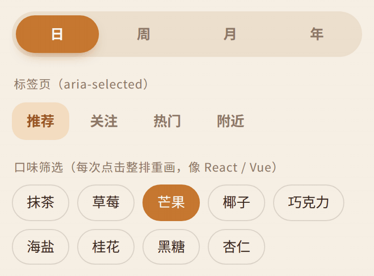
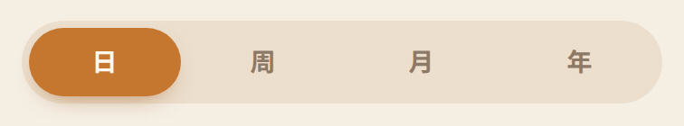
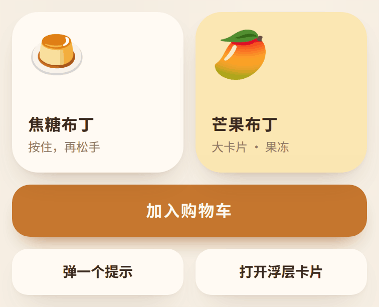
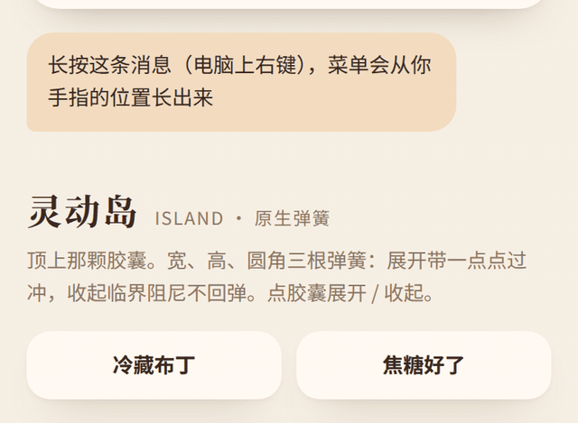
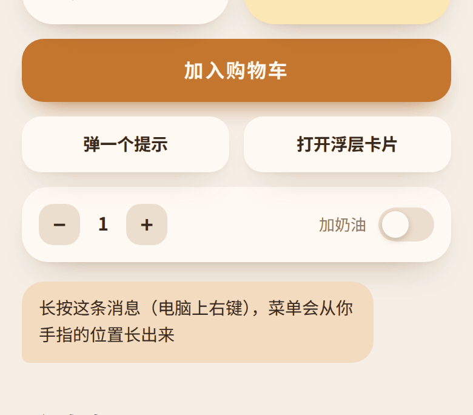
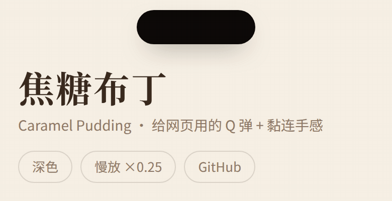
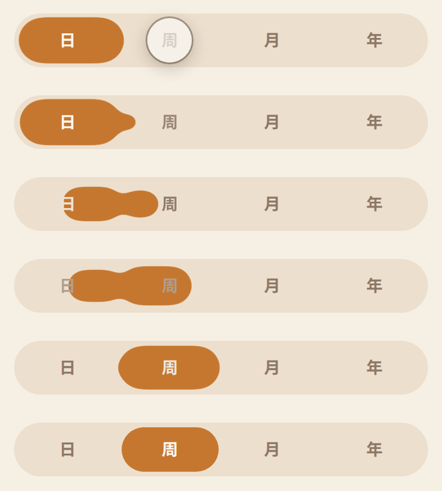

<div align="center">

# 焦糖布丁 · Caramel Pudding

**给网页用的「Q 弹 + 黏连」手感**

按下去像布丁一样 duang 一下，选中的颜色像熬化的焦糖一样，从旧的那颗流到新的那颗。

一个 JS 文件 · 零依赖 · 引进来就生效 · MIT

[**在线试玩**](https://wave2234.github.io/caramel-pudding/) · [哪里用哪个](#哪里用果冻哪里用黏连) · [给你的 AI 看的一段话](#给你的-ai-看的一段话)



<sub>Jelly press + gooey “caramel” selection for any web UI. One file, zero dependencies.</sub>

</div>

---

## 这是什么

名字取自一份焦糖布丁：底下的布丁 Q 弹，上面的焦糖黏糊糊、会流动。

| | 是什么 | 用在哪 |
|---|---|---|
| 🍮 **布丁** Pudding | 按下去压扁一点，松手像布丁一样横着摊开、竖着弹起、抖两下落定；浮层「啵」地弹出来；长按菜单从手指按住的地方长出来 | 大卡片、大按钮、浮层、长按菜单 |
| 🍯 **焦糖** Caramel | 一排圆角按钮里只亮一颗的时候，那颗颜色被拉出糖丝、挤成一滴、流到新的那颗再鼓起来。按住还没松手时，旧的会先被「吸」过来一点，像表面张力 | 分段选择、Tab、筛选、底栏、日期格子 |
| 🫧 **灵动岛** Island | 顶部胶囊的展开 / 收起：宽、高、圆角三根弹簧，动真实尺寸不动 scale | 常驻的状态胶囊、通知 |

不用改你的组件：引入以后，它会自己判断页面上每个可点的东西该怎么动；判断不对的，用一个属性纠正。

## 效果

<p align="center"><br><sub>焦糖 · 慢放 ×0.25：相邻时拉丝黏连，隔得远时挤出一滴糖珠滑过去</sub></p>

<p align="center"><br><sub>布丁 · 大卡片按住再松手、大按钮</sub></p>

<p align="center"><br><sub>长按菜单从手指的位置长出来</sub></p>

<p align="center"><br><sub>Toast、浮层卡片「啵」地弹出来</sub></p>

<p align="center"><br><sub>灵动岛 · 原生弹簧</sub></p>

> 手机上的手感比动图好得多，去 [在线试玩](https://wave2234.github.io/caramel-pudding/) 戳一戳；页面顶上有「慢放 ×0.25」。

## 快速开始

```html
<script src="caramel-pudding.js" defer></script>
```

就这样。页面上的按钮、卡片、Tab 会自动分档。另外三件事需要你在出现浮层的地方告诉它：

```js
toast.classList.add('cp-pop');            // 浮层、弹窗、Toast：出现时「啵」地弹出来
menu.classList.add('cp-menu');            // 长按 / 右键菜单：显示时从手指位置长出来
await CaramelPudding.out(menu, 'hide');   // 收起：缩一下淡出，结束后设 hidden（或 'remove' 删掉）
```

灵动岛是可选的，另一个文件：

```html
<script src="island.js"></script>
<script>
  const island = new CaramelIsland(el, { bean: { w: 118, h: 34, r: 17 } });  // 收起时那颗「豆子」
  island.to({ w: 360, h: 150, r: 38 }, { open: true });   // 展开
  island.to({ w: 198, h: 34, r: 17 });                     // 胶囊里换了内容
  island.to(island.bean, { hide: true });                  // 收起并淡出
</script>
```

### 属性

| 写在哪 | 写法 | 作用 |
|---|---|---|
| 元素 | `data-cp="pudding"` | 最 Q 的果冻（角色卡、封面卡） |
| 元素 | `data-cp="press"` | 只要轻压 + 小回弹 |
| 元素 | `data-cp="tiny"` | 只淡一下 |
| 元素 | `data-cp="none"` | 不动（连同里面的所有元素） |
| 一排的容器 | `data-cp-group` | 强制把子元素当「单选」，走焦糖 |
| 一排的容器 | `data-cp-group="off"` | 这一排不要焦糖（比如它自己有滑动指示条） |
| 浮层 | `class="cp-pop"` | 出现时弹出来 |
| 菜单 | `class="cp-menu"` | 从手指位置长出来；`--cp-radius` 设成菜单的圆角 |

### JS

| | |
|---|---|
| `CaramelPudding.tier(el)` | 看某个元素被分到哪一档：`pudding` `card` `big` `press` `tiny` `choice` `none` |
| `CaramelPudding.flow(oldEl, newEl)` | 自动检测不到时（比如状态 150ms 以后才变），在换完选中态之后手动让糖浆流过去 |
| `CaramelPudding.pop(el)` · `.menu(el, x, y)` · `.out(el, 'hide' \| 'remove')` | 浮层 |
| `CaramelPudding.setSpeed(0.25)` | 全局慢放，调参、录屏用 |
| `CaramelPudding.config` | `pudding` / `caramel` 开关，`touchDelay`（70ms），`moveCancel`（10px） |
| `CaramelPudding.bind(iframe.contentDocument)` | 同源 iframe 里的页面也接上 |

## 哪里用果冻，哪里用黏连

这一节是整个教程最重要的部分。动效不是越多越好——用错地方，Q 弹会变成「作」。

```
点了会有反应的东西
├─ 在「一排里同一时间只亮一颗」的圆角块里？ ─→ 🍯 焦糖：按下只淡一下，选中色流过去
├─ 大卡片 / 大按钮？ ───────────────────────→ 🍮 布丁：压扁 → 松手抖两下
├─ 普通大小的按钮？ ────────────────────────→ 轻压 + 小回弹
├─ 小东西（≤34px、开关、小字、列表行）？ ────→ 只淡一下，绝不晃
└─ 输入框 / 媒体 / 自己有动画的？ ──────────→ 不动
```

### 🍯 焦糖（黏连）

**用在：** 同一时间只有一颗亮着、亮起来的是一块**有底色的圆角形状**的一排东西。

- 分段选择（日 / 周 / 月 / 年、列表 / 网格）
- 标签页 Tab（亮起来是一块浅色药丸的那种）
- 筛选 chip、标签、分类
- 底部导航栏——亮的可以是按钮本身，也可以是图标后面那颗小药丸
- 日期、时间段、尺码、档位、评分这类格子（二维的也行，糖珠会斜着流过去）
- 多选也可以：没有「旧的」可以流，新亮起的那颗会从手指按下的地方鼓起来

**别用在：**

- 只有文字变色、下面一条细下划线的 Tab——更适合一条滑动指示条（没有底色时它只会画一抹很淡的文字色，想完全关掉就 `data-cp-group="off"`）
- 自己已经有滑动指示条 / 动画的组件（`data-cp-group="off"`）
- 大卡片式的选择（选套餐、选角色卡）——那种用布丁
- 列表行、设置项、菜单项

### 🍮 布丁（果冻）

**用在：**

- 大卡片：角色卡、封面卡、商品卡、相册卡（自动：≥ 132×90，有底色 / 阴影 / 边框）
- 大按钮：主按钮、发送、确认、底部通栏按钮（自动：有底色、≥ 110×40；越宽晃得越少）
- 浮层：弹窗、底部抽屉、Toast、悬浮卡片——出现时加 `cp-pop`
- 长按菜单、右键菜单——加 `cp-menu`

**只淡一下、不晃：** 小字链接、图标按钮、开关、复选框、数量加减、「回到底部」那种小箭头、列表行、菜单项。

**完全不动：** 输入框、可编辑区域、视频 / 音频 / canvas；**自己会展开 / 收起的卡片**（两套形变会打架，`data-cp="none"`）；正在拖拽的东西；常驻悬浮、自带弹簧的东西（灵动岛、悬浮球）。

## 原理

### 🍮 布丁：按下 & 松手

用 Web Animations API 驱动**独立的 `scale` 属性**，不碰元素自己的 `transform`（你的 `translate(-50%)` 居中不会被冲掉）。

振幅 `a` 按大小分档：大卡片 0.85、大按钮 0.75、普通按钮 0.55；比屏幕宽度 70% 还宽的再打折（0.5 / 0.42）——整条横幅一起抖会很吵。

```
按下   scale → 1 − 0.075a        340ms  cubic-bezier(.34,1.56,.64,1)   带一点过冲，像被手指压进去

松手   700ms，整段 cubic-bezier(.3,.7,.4,1)，关键帧（横, 竖）：
       0.00  (1 − .08a ,  1 − .08a )   还压着
       0.28  (1 + .12a ,  1 − .13a )   横着摊开
       0.48  (1 − .07a ,  1 + .08a )   竖着弹起
       0.66  (1 + .035a,  1 − .035a)
       0.82  (1 − .012a,  1 + .012a)
       1.00  (1, 1)

普通按钮  420ms：1 − .05a → 1 + .025a → 1
小东西    不缩放，不透明度 → 62%（100ms），松手 200ms 回来
```

两个防误触的细节：触屏按住 **70ms** 才压下去；按下后手指移动超过 **10px** 就当作在滑动、轻轻弹回去——滑动列表时按钮不会乱缩。

### 🍮 布丁：弹出 & 菜单

纯 CSS，同样用独立的 `translate` / `scale` 属性：

```css
@keyframes cp-pop {   /* 580ms：从下面弹上来，落定前轻轻晃一下 */
  0%   { opacity: 0; translate: 0 24px; scale: .86;        animation-timing-function: cubic-bezier(.2,.8,.3,1) }
  50%  { opacity: 1; translate: 0 -4px; scale: 1.03 .975;  animation-timing-function: cubic-bezier(.45,0,.55,1) }
  70%  { translate: 0 1px;  scale: .988 1.016 }
  86%  { translate: 0 0;    scale: 1.004 .997 }
  100% { opacity: 1; translate: 0 0; scale: 1 }
}
@keyframes cp-menu {  /* 600ms：一滴圆圆的液体，从手指的位置长成一张卡片 */
  0%   { opacity: 0; scale: .16 .1; border-radius: 999px;            animation-timing-function: cubic-bezier(.2,.8,.3,1) }
  18%  { opacity: 1 }
  46%  { scale: 1.05 .955; border-radius: var(--cp-radius, 16px);  animation-timing-function: cubic-bezier(.45,0,.55,1) }
  66%  { scale: .982 1.03;                                          animation-timing-function: cubic-bezier(.45,0,.55,1) }
  84%  { scale: 1.007 .993 }
  100% { opacity: 1; scale: 1 }
}
.cp-menu      { animation: cp-menu 600ms backwards; transform-origin: var(--cp-ox) var(--cp-oy); }
.cp-menu > *  { animation: cp-menu-in 360ms 130ms backwards; }   /* 菜单项晚 130ms 再淡入、上浮 4px */
```

菜单的 `transform-origin` 是手指按下的那个点：脚本记住最后一次按下的位置，`MutationObserver` 看到 `.cp-menu` 从隐藏变成显示时，把 `--cp-ox / --cp-oy` 设过去。

### 🍯 焦糖：糖浆是怎么画的

<p align="center"><br><sub>松手后 0 / 90 / 180 / 260 / 340 / 520ms：被拉住 → 拉出糖丝 → 两颗连成一团 → 流过去 → 过冲 → 落定</sub></p>

**1. 一层放在按钮后面的「糖浆层」。** 在这一排按钮里插一个 `div`：`position:absolute; z-index:-1; pointer-events:none`，父元素加 `isolation:isolate`。于是它画在这一排的底色**之上**、按钮文字**之下**——文字永远在糖浆上面，不会被滤镜糊掉。

**2. 黏连滤镜。** 只套在这一层上：

```html
<filter id="goo" x="-40%" y="-80%" width="180%" height="260%" color-interpolation-filters="sRGB">
  <feGaussianBlur in="SourceGraphic" stdDeviation="5.5" result="blur"/>
  <feColorMatrix in="blur" mode="matrix"
                 values="1 0 0 0 0  0 1 0 0 0  0 0 1 0 0  0 0 0 19 -8" result="goo"/>
  <feComposite in="SourceGraphic" in2="goo" operator="atop"/>
</filter>
```

模糊让靠近的形状边缘糊在一起；透明度 ×19 − 8 再把糊边「收紧」成一条清楚的边——两颗靠近的圆中间就会长出一条液体的颈。模糊半径按按钮高度取 4 / 5.5 / 7。

**3. 糖块。** 层里是几个绝对定位的 `<i>`，动画 `left / top / width / height / border-radius`。动画期间，旧的和新的按钮自己的底色被藏起来（`!important` 透明，同时关掉过渡），颜色全由糖浆层来画；结束时糖块正好和新按钮的底色重合，再把底色还回去——无缝。

**4. 检测（零配置的关键）。** 按下之前给这一排每颗按钮拍一张「快照」：class、`aria-selected / aria-current / aria-pressed / aria-checked`、`data-state`、背景色、文字色、边框、字重，以及里面两层子元素的底色。点击之后，在同步、微任务、下一帧、150ms 四个时机各对比一次，找出「谁灭了、谁亮了」。

- 读新样式前先临时关掉过渡，不然读到的是过渡的起点。
- 框架把整排 DOM 换掉了（React / Vue 重渲染）也没关系：按旧位置 `elementFromPoint` + 文字把新节点找回来。
- 只有样式变了、class 和 aria 都没变时，要求至少两颗一起变——免得把 hover 当成选中。

**5. 四种流法。**

| 情况 | 时长 | 怎么流 |
|---|---|---|
| 相邻 | 500ms | 旧的先被拉长 5px（被拉住）→ 缩成 60%×72% 往新的方向挪 → 缩成一颗糖珠，越来越快地被吸进去；新的从靠近那一侧冒出一颗小珠 → 鼓成 70%×82% → 过冲 103.5%×95.5% → 99%×102% → 落定。中间缝宽就补一段糖丝 |
| 隔得远，中间是空的 | 560–760ms | 旧的挤出一滴糖珠，后面拖一条小尾巴，沿直线滑过去（糖珠会沿运动方向转过去）；新的晚一点（56% 处）才鼓起来 |
| 隔得远，中间的按钮自己有底色 | 580ms | 糖珠会钻到它们下面看不见，所以改成原地收、原地鼓 |
| 之前没有亮着的 | 480ms | 一滴从手指按下的地方鼓起来、铺满 |

文字颜色跟着糖走：旧的在 30%→60% 之间变暗，新的在 42%→72% 之间变亮。

**6. 按住还没松手。** 旧的那颗先往手指的方向被吸过去最多 7px，离得近的话新的那颗边上冒一颗小芽——这就是表面张力的那一下；手指滑走就弹回去。连点的时候，从上一段糖浆「现在的形状」接着流，不跳回去。

### 🫧 灵动岛：原生弹簧

移植自一套 Android 原生实现，核心就两句话：**动的是真实的宽、高、圆角，不是 scale**（字不会被拉伸）；**三根单位质量的阻尼弹簧，用同一个力**，每帧用解析解推进（任何帧率都稳，不会因为掉帧而「爆掉」）。

| 阶段 | 刚度 k | 阻尼比 ζ | 手感 |
|---|---|---|---|
| 展开 | 280 | 0.8 | 只过冲一点点 |
| 收起 | 1200 | 1（临界阻尼） | 干脆不回弹；约 190ms 先回到胶囊高度，再只在水平方向弹到最终宽度 |
| 胶囊里换内容 | 200 | 0.65 | 轻轻弹一下 |
| 拖拽松手回位 | 300 | ≈0.38（c = 13） | 过冲一点再回来 |

内容交接：旧内容 50–60ms 内就淡掉，不和新内容叠在一起；新内容等形状长到 40% 以后，从 75ms 起、225ms 内从模糊 12px 变清楚。出现 80ms 淡入，隐藏 150ms 淡出。系统关掉动画时直接跳到终点。

原生端（Kotlin）的核心就是这一步，每帧对宽、高、圆角各调一次，然后改 `LayoutParams`：

```kotlin
/** 单位质量阻尼弹簧，解析解推进 dt 秒。k = 刚度，z = 阻尼比。返回 (位置, 速度) */
fun springStep(x: Float, v: Float, goal: Float, k: Float, z: Float, dt: Float): Pair<Float, Float> {
    val d = x - goal
    val w = sqrt(k)
    val decay = exp(-z * w * dt)
    if (z >= 1f) {                       // 临界阻尼
        val b = v + w * d
        return Pair(goal + (d + b * dt) * decay, (v - w * b * dt) * decay)
    }
    val wd = w * sqrt(1f - z * z)        // 欠阻尼
    val b = (v + z * w * d) / wd
    val c = cos(wd * dt); val s = sin(wd * dt)
    val off = d * c + b * s
    return Pair(goal + off * decay, ((-d * wd * s + b * wd * c) - z * w * off) * decay)
}
```

网页端就是 [`island.js`](island.js)，同一套参数。

## 踩过的坑

1. **别做过头。** 回弹宁小勿大；越宽的东西晃得越少；常驻的东西（状态胶囊、悬浮球）回弹太明显会显得很「作」——用原生弹簧，或者干脆不晃。
2. **小东西别晃。** 开关、小字、小箭头一晃就像出了 bug，只淡一下。
3. **别在按钮上盖「玻璃镜片 / 折射」。** 位移滤镜那种液态玻璃字会糊、抢戏。黏连的液体感应该来自**颜色的流动和表面张力**，而不是把按钮本身变形。
4. **滤镜只套糖浆那一层。** 别给整排按钮加 `filter`：会糊字，也会掉帧。
5. **糖浆层放在按钮后面。** 父元素 `isolation: isolate` + 层 `z-index: -1`。
6. **过渡要先关后开。** 读最终颜色前关掉过渡；还回底色时也要先在「过渡关着」的时候还，再把过渡打开——否则会从透明慢慢渐变回来，闪一下。
7. **插子元素前后量一下。** `:last-child` 之类的样式可能因为多了一个子元素而变化、把按钮挤动——变了就换到第一个子元素，还变就放弃这一次。
8. **用独立的 `scale` / `translate` 属性。** 不碰元素自己的 `transform`；反过来，加了 `cp-pop` 的浮层别用 `translate` 属性居中，用 `transform` 或 `left / right`。
9. **自己会展开的卡片不要再加果冻**，两套形变会打架。
10. **触屏延迟 70ms 再压、移动 10px 取消**；`prefers-reduced-motion` 时全部关掉。

## 给你的 AI 看的一段话

把下面这段连同这个仓库的链接一起发给你的 AI（Claude、Codex、Cursor……都行）：

```text
请给我的前端接入「焦糖布丁」手感：https://github.com/wave2234/caramel-pudding
（先读 README 的「哪里用果冻，哪里用黏连」和「踩过的坑」两节）

1. 所有页面引入 caramel-pudding.js（零依赖，引入即自动生效）。
   同源 iframe 里的页面用 CaramelPudding.bind(iframe.contentDocument) 接上。

2. 逐个检查可点击的东西，自动分档不对的用属性纠正：
   - 「一排里同一时间只亮一颗、亮起来是一块有底色的圆角形状」（分段、Tab、筛选 chip、底栏、日期格子）→ 焦糖。
     选中状态要写在 class（on / active / selected …）或 aria-selected / aria-current / aria-pressed / data-state 上；
     还是识别不到的那一排，在容器上加 data-cp-group。
   - 大卡片（角色卡、封面卡、商品卡）→ 布丁；最想要 Q 的加 data-cp="pudding"。
   - 大按钮 → 布丁（自动）；只想轻压的加 data-cp="press"。
   - 小字、图标按钮、开关、列表行 → 只淡一下（自动；必要时 data-cp="tiny"）。
   - 输入框、媒体、自己会展开的卡片、常驻悬浮的东西 → data-cp="none"；
     自带滑动指示条的那一排 → 容器上 data-cp-group="off"。

3. 浮层（弹窗、底部抽屉、Toast、悬浮卡片）出现时加 class="cp-pop"；
   长按 / 右键菜单加 class="cp-menu"，并把 --cp-radius 设成菜单的圆角；
   关闭时 await CaramelPudding.out(el, 'hide')。

4. 不要：给按钮盖玻璃镜片 / 折射效果；给整排按钮加 filter；把回弹调得比默认更大；给开关、小字加果冻。

5. 验收：用 CaramelPudding.tier(el) 抽查每类元素的档位；CaramelPudding.setSpeed(0.25) 慢放走一遍；
   打开系统的「减少动态效果」后应该完全不动；控制台没有报错。

6. 如果有原生壳里的顶部状态胶囊（灵动岛）：照 README「灵动岛」那一节，
   用宽、高、圆角三根弹簧（展开 k=280 ζ=0.8；收起 k=1200 ζ=1，190ms 后只水平弹到最终宽度；
   换内容 k=200 ζ=0.65），不要用 scale，也不要再套果冻。
```

## 文件

```
caramel-pudding.js   核心：布丁 + 焦糖 + 弹出 / 菜单，一个文件
island.js            灵动岛弹簧（网页版），可选
index.html           演示页，也就是「在线试玩」那一页
docs/                README 里的动图
```

## 兼容性

现代浏览器：Chrome / Edge 104+、Safari 15.4+、Firefox 103+ 左右。用到了 Web Animations API、独立的 `scale` / `translate` 属性和 SVG 滤镜，不支持的环境会安静地退化成没有动画。Shadow DOM 里的组件暂不支持。

## 致谢

- 黏连滤镜的做法（高斯模糊 + 透明度阈值 + `atop` 合成）来自 Lucas Bebber 在 Codrops 发表的 [Creative Gooey Effects](https://tympanus.net/codrops/2015/03/10/creative-gooey-effects/)（2015）。

## License

[MIT](LICENSE) © wave2234
